<div align="center">



<a href="https://github.com/zabrodsk">
  
</a>

<br/>


</div>

<br/>

## `$ cat about.md`

```ts
const dusan = {
  builds:   ["AI agents", "MCP servers", "native Apple apps", "web toys"],
  research: "LLM multi-agent systems for startup evaluation (EACL 2026)",
  loves:    ["local-first software", "tiny polished tools", "F1 live timing"],
  rule:     "ship it this weekend, polish it next weekend",
};
```

## `$ ls ./featured`

<table>
<tr>
<td width="50%" valign="top">

### 🤖 [bot2bot](https://github.com/zabrodsk/bot2bot)
Your AI bot talks to *their* bot. End-to-end encrypted messaging between personal AI assistants for family and friends.

[](https://www.bot2bot.link) 

</td>
<td width="50%" valign="top">

### 🤝 [a2a-business-platform](https://github.com/zabrodsk/a2a-business-platform)
Agent-to-agent infrastructure for businesses: discovery, negotiation and authorized transactions, with registry, audit rules and payment adapters.

[](https://pneu007-production.up.railway.app) 

</td>
</tr>
<tr>
<td width="50%" valign="top">

### 📈 [Rockaway Deal Intelligence](https://github.com/zabrodsk/Rockaway-Deal-Intelligence)
Multi-agent LLM system that evaluates startups from pitch decks, Specter exports and live web search. Paper at **EACL 2026**.


</td>
<td width="50%" valign="top">

### 📚 [proof](https://github.com/zabrodsk/proof)
Academic citation checking. A local research app that catches citations that don't say what you claim they say.


</td>
</tr>
<tr>
<td width="50%" valign="top">

### 🌸 [plume](https://github.com/zabrodsk/plume)
A minimalist Markdown editor for macOS where every letter blooms.


</td>
<td width="50%" valign="top">

### ☁️ [cumulus](https://github.com/zabrodsk/cumulus)
Black-and-white weather for iPhone and Apple Watch. Live Activities, MeteoAlarm alerts and hand-drawn Canvas icons.


</td>
</tr>
<tr>
<td width="50%" valign="top">

### ⏰ [Minder](https://github.com/zabrodsk/Minder)
Open-source macOS reminders and focus timers. Focus-proof full-screen alerts, drag-to-set timers, Apple Reminders sync.


</td>
<td width="50%" valign="top">

### 🏎️ [pitlane-live](https://github.com/zabrodsk/pitlane-live)
Real-time F1 and F2 live timing dashboard with a prediction engine. Bun + TypeScript, self-hosted.


</td>
</tr>
</table>

<details>
<summary><b>🧪 More experiments</b> (click to open)</summary>
<br/>

| Project | What it is |
|---|---|
| [portly](https://github.com/zabrodsk/portly) | macOS menu bar app that lists local dev servers and kills them in one click |
| [partydeck](https://github.com/zabrodsk/partydeck) | Poker and blackjack for friends: one shared table, private phone hands |
| [open-safe-europe](https://github.com/zabrodsk/open-safe-europe) | Free, open-source SAFE agreement drafting for European founders |
| [keep-webmcp](https://github.com/zabrodsk/keep-webmcp) | Local-first relationship desk where WebMCP does the memory work |
| [elite-comms](https://github.com/zabrodsk/elite-comms) | macOS Model UN assistant with on-device transcription |
| [relay](https://github.com/zabrodsk/relay) | iPhone recorder → Whisper → Ollama → Notion, all local |
| [casino-climb](https://github.com/zabrodsk/casino-climb) | A browser game. [Play it](https://casino-climb.pages.dev/) |
| [claude-advisor-plugin](https://github.com/zabrodsk/claude-advisor-plugin) | Claude Code plugin: Opus plans and reviews, Sonnet subagents build |

</details>

## `$ which stack`

<p align="center">
  <a href="https://skillicons.dev">
    
  </a>
</p>

## `$ git log --stat`

<p align="center">
  
</p>

<p align="center">
  
  
</p>

<div align="center">

<br/>

<sub>made with too much coffee · last commit was probably at 2am</sub>


</div>
